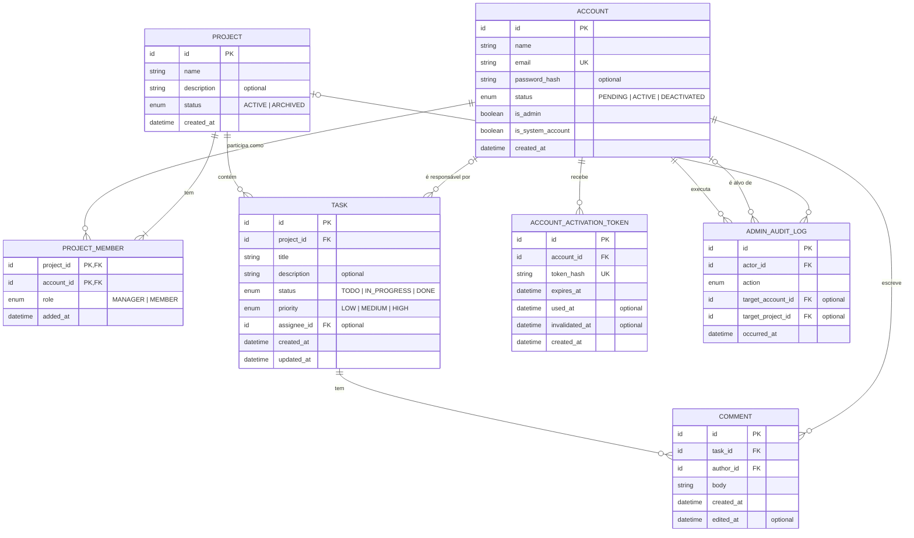

# Modelo de dados — Matriz

Este ficheiro descreve o modelo de dados lógico do MVP (FN01–FN09, FN12–FN14, FN27, FN28). Deriva de [requirements.md](requirements.md), [user-stories.md](user-stories.md), [constraints.md](constraints.md) e da arquitetura em [architecture.md](architecture.md).

O modelo é **lógico**: não fixa os tipos físicos. A base de dados é PostgreSQL, gerida com Prisma (migrations e seed), e os identificadores são UUID (D04 e pontos complementares em [constraints.md](constraints.md#4-decisões-técnicas); decisões internas, por validar). Os tipos indicados (`id`, `string`, `boolean`, `enum`, `datetime`) são genéricos; `id` é um UUID. Tal como o resto da especificação, **nenhuma regra foi validada pelo cliente**.

**Convenção de nomes:** entidades, atributos, valores de `enum` e módulos têm nomes em inglês, para serem usados tal e qual no código. A documentação e a interface continuam em português; a coluna "Termo" e as notas indicam o termo do glossário e o texto mostrado ao utilizador.

## 1. Entidades

| Entidade | Termo | O que representa | Módulo dono (architecture.md §4) |
|---|---|---|---|
| ACCOUNT | Conta | O acesso identificado de uma pessoa. | Autenticação e contas (`accounts`) |
| PROJECT | Projeto | Um conjunto de tarefas com nome, descrição, membros e estado (R6). | Projetos e membros (`projects`) |
| PROJECT_MEMBER | membro do projeto | A participação de uma conta num projeto e a sua função nesse projeto (Gestor ou Membro). Resolve a relação N:M entre ACCOUNT e PROJECT. | Projetos e membros (`projects`) |
| TASK | Tarefa | Uma tarefa de um projeto (R7). | Tarefas e comentários (`tasks`) |
| COMMENT | Comentário | Um comentário de uma conta numa tarefa (FN14). | Tarefas e comentários (`tasks`) |
| ACCOUNT_ACTIVATION_TOKEN | Token de ativação | Um token de uso único enviado por email para a pessoa definir a palavra-passe (DE15). | Autenticação e contas (`accounts`) |
| ADMIN_AUDIT_LOG | Registo de ações administrativas | Uma entrada do registo (FN28, PN18). | Registo administrativo (`audit`) |

Não há entidade "Equipa": a equipa de um projeto são as linhas de PROJECT_MEMBER desse projeto (R6). Não há entidade "Progresso": o indicador é calculado a partir de TASK (FN09, PN13) e não é guardado. "Administrador" não é uma entidade nem uma função: é um atributo de ACCOUNT (DE02).

## 2. Atributos

Legenda: **PK** chave primária · **FK** chave estrangeira · **UK** valor único · **Obr.** obrigatório.

### ACCOUNT (Conta)

| Atributo | Tipo | Chave | Obr. | Notas | Origem |
|---|---|---|---|---|---|
| id | id | PK | Sim | Identificador interno. | — |
| name | string | | Sim | Nome. Mostrado como autor, responsável e no registo. | Glossário, US02 |
| email | string | UK | Sim | Único, incluindo contas desativadas. | PN11 |
| password_hash | string | | Não | Hash bcrypt da palavra-passe. Vazio só enquanto a conta está `PENDING`. A palavra-passe é definida pela própria pessoa ao ativar a conta (pelo menos 12 caracteres) e nunca é guardada nem devolvida em claro. | D06, DE15 |
| status | enum | | Sim | `PENDING` ("Pendente"), `ACTIVE` ("Ativa") ou `DEACTIVATED` ("Desativada"). Começa em `PENDING`; passa a `ACTIVE` quando a pessoa define a palavra-passe; `PENDING` e `ACTIVE` podem passar a `DEACTIVATED`; não sai de `DEACTIVATED`. A conta de sistema é criada já em `ACTIVE`. | US02, PN17, DE15 |
| is_admin | boolean | | Sim | Permissão de Administrador. Começa em falso. | DE02, DE05, US02 |
| is_system_account | boolean | | Sim | Verdadeiro só na conta de sistema, criada pela equipa do projeto. | DE04, PN16 |
| created_at | datetime | | Sim | | — |

A autenticação usa JWT (D06). Em ACCOUNT fica o hash da palavra-passe (`password_hash`); os tokens de ativação ficam em ACCOUNT_ACTIVATION_TOKEN.

### ACCOUNT_ACTIVATION_TOKEN (Token de ativação)

| Atributo | Tipo | Chave | Obr. | Notas | Origem |
|---|---|---|---|---|---|
| id | id | PK | Sim | Identificador interno. | — |
| account_id | id | FK → ACCOUNT | Sim | Conta a ativar. | DE15 |
| token_hash | string | UK | Sim | Hash do token enviado no link de ativação. O token em claro nunca é guardado. | DE15 |
| expires_at | datetime | | Sim | 24 horas depois de `created_at`. | DE15 |
| used_at | datetime | | Não | Preenchido quando o token é usado para ativar a conta. | DE15 |
| invalidated_at | datetime | | Não | Preenchido quando o token deixa de valer sem ter sido usado: reenvio do convite ou desativação da conta. | DE15 |
| created_at | datetime | | Sim | | — |

Um token só é válido se `used_at` e `invalidated_at` estiverem vazios e `expires_at` ainda não tiver passado.

### PROJECT (Projeto)

| Atributo | Tipo | Chave | Obr. | Notas | Origem |
|---|---|---|---|---|---|
| id | id | PK | Sim | Identificador interno. | — |
| name | string | | Sim | Nome, com 3 a 100 caracteres e não só espaços, contados sem os espaços das pontas; fica guardado sem eles (decisão interna, 2026-11-09). Não se exige que seja único. | PN12 |
| description | string | | Não | Descrição, até 1000 caracteres. Uma descrição vazia ou só com espaços fica vazia ("sem descrição"; decisão interna, 2026-11-09). | PN12 |
| status | enum | | Sim | `ACTIVE` ("Ativo") ou `ARCHIVED` ("Arquivado"). Começa em `ACTIVE`. | R6, US03, US10 |
| created_at | datetime | | Sim | | — |

### PROJECT_MEMBER (membro do projeto)

| Atributo | Tipo | Chave | Obr. | Notas | Origem |
|---|---|---|---|---|---|
| project_id | id | PK, FK → PROJECT | Sim | | R6 |
| account_id | id | PK, FK → ACCOUNT | Sim | | DE01 |
| role | enum | | Sim | Função: `MANAGER` ("Gestor") ou `MEMBER` ("Membro"). Exatamente uma linha `MANAGER` por projeto. | DE01, DE06, PN03 |
| added_at | datetime | | Sim | | — |

A chave primária composta (project_id, account_id) impede que a mesma conta apareça duas vezes no mesmo projeto.

### TASK (Tarefa)

| Atributo | Tipo | Chave | Obr. | Notas | Origem |
|---|---|---|---|---|---|
| id | id | PK | Sim | Identificador interno. | — |
| project_id | id | FK → PROJECT | Sim | Uma tarefa pertence sempre a um projeto. | R6, P3 |
| title | string | | Sim | Título, com 3 a 150 caracteres e não só espaços, contados sem os espaços das pontas; fica guardado sem eles (decisão interna, 2026-11-10). | PN12 |
| description | string | | Não | Descrição, até 2000 caracteres. Uma descrição vazia ou só com espaços fica vazia ("sem descrição"; decisão interna, 2026-11-10). | PN12 |
| status | enum | | Sim | `TODO` ("Por fazer"), `IN_PROGRESS` ("Em curso") ou `DONE` ("Concluída"). Começa em `TODO`; qualquer transição é permitida. | R8, PN10 |
| priority | enum | | Sim | `LOW` ("Baixa"), `MEDIUM` ("Média") ou `HIGH` ("Alta"). Por omissão `MEDIUM`; as tarefas que já existiam ficam `MEDIUM` (decisão interna, 2026-11-10). Só o Gestor a define e muda. | FN12, PN19 |
| assignee_id | id | FK → ACCOUNT | Não | Responsável. Vazio = "Sem responsável". Referencia ACCOUNT (e não PROJECT_MEMBER) para uma tarefa "Concluída" manter o responsável quando este sai do projeto; nesse caso, mostra-se "já não é membro", calculado pela ausência de linha em PROJECT_MEMBER. Que o responsável é membro com conta ativa é verificado pela aplicação quando é escolhido. | DE09, DE14, PN06, PN07 |
| created_at | datetime | | Sim | | — |
| updated_at | datetime | | Sim | | — |

### COMMENT (Comentário)

| Atributo | Tipo | Chave | Obr. | Notas | Origem |
|---|---|---|---|---|---|
| id | id | PK | Sim | Identificador interno. | — |
| task_id | id | FK → TASK | Sim | | US13 |
| author_id | id | FK → ACCOUNT | Sim | Referencia ACCOUNT (e não PROJECT_MEMBER) para o comentário se manter quando o autor sai do projeto. | PN15, CL12 |
| body | string | | Sim | Texto do comentário, com 1 a 2000 caracteres e não só espaços. | PN15 |
| created_at | datetime | | Sim | Mostrado com o nome do autor. | US13 |
| edited_at | datetime | | Não | Preenchido quando o autor edita. | US13 |

### ADMIN_AUDIT_LOG (Registo de ações administrativas)

| Atributo | Tipo | Chave | Obr. | Notas | Origem |
|---|---|---|---|---|---|
| id | id | PK | Sim | Identificador interno. | — |
| actor_id | id | FK → ACCOUNT | Sim | Administrador que executou a ação (autor). | PN18 |
| action | enum | | Sim | `CREATE_ACCOUNT` ("Criar conta"), `RESEND_INVITE` ("Reenviar convite"), `DEACTIVATE_ACCOUNT` ("Desativar conta"), `GRANT_ADMIN` ("Dar permissão de Administrador"), `REVOKE_ADMIN` ("Retirar permissão de Administrador"), `CREATE_PROJECT` ("Criar projeto"), `ASSIGN_MANAGER` ("Atribuir Gestor"), `CHANGE_MANAGER` ("Trocar Gestor"), `ADD_MEMBER` ("Adicionar membro"). | PN18, DE15 |
| target_account_id | id | FK → ACCOUNT | Não | Conta afetada, quando existe. | PN18, US14 |
| target_project_id | id | FK → PROJECT | Não | Projeto afetado, quando existe (criar projeto, trocar Gestor, adicionar membro). | PN18 |
| occurred_at | datetime | | Sim | Data e hora da ação. | PN18 |

Pelo menos um dos alvos tem de estar preenchido. As entradas nunca são alteradas nem apagadas (PN18).

## 3. Relacionamentos e cardinalidades

| Relacionamento | Cardinalidade | Leitura | Origem |
|---|---|---|---|
| ACCOUNT — PROJECT_MEMBER | 1 : 0..N | Uma conta participa em zero ou mais projetos; cada participação é de uma só conta. | DE01, R5 |
| ACCOUNT — ACCOUNT_ACTIVATION_TOKEN | 1 : 0..N | Uma conta tem zero ou mais tokens de ativação (um por envio do convite); cada token é de uma só conta. No máximo um está válido. | DE15 |
| PROJECT — PROJECT_MEMBER | 1 : 1..N | Um projeto tem pelo menos um membro (o Gestor); cada participação é de um só projeto. | DE06, PN03 |
| ACCOUNT — PROJECT (via PROJECT_MEMBER) | N : M | Uma conta pode estar em vários projetos e um projeto tem várias contas. | DE01, R6 |
| PROJECT — TASK | 1 : 0..N | Um projeto tem zero ou mais tarefas; uma tarefa pertence a exatamente um projeto. | R6, P3 |
| ACCOUNT — TASK (responsável) | 0..1 : 0..N | Uma tarefa tem zero ou um responsável; uma conta pode ser responsável por várias tarefas. Ao ser escolhido, o responsável é membro do projeto; numa tarefa "Concluída" pode já não o ser. | DE09, DE14, PN06, PN07 |
| TASK — COMMENT | 1 : 0..N | Uma tarefa tem zero ou mais comentários; um comentário é de uma só tarefa. | FN14 |
| ACCOUNT — COMMENT (autor) | 1 : 0..N | Uma conta escreve zero ou mais comentários; um comentário tem exatamente um autor. | PN15 |
| ACCOUNT — ADMIN_AUDIT_LOG (autor) | 1 : 0..N | Um Administrador executa zero ou mais ações registadas. | PN18 |
| ACCOUNT — ADMIN_AUDIT_LOG (alvo) | 0..1 : 0..N | Uma entrada pode ter uma conta como alvo. | PN18 |
| PROJECT — ADMIN_AUDIT_LOG (alvo) | 0..1 : 0..N | Uma entrada pode ter um projeto como alvo. | PN18 |

## 4. Regras de integridade

Regras que o modelo tem de garantir. A coluna "Onde" indica se a regra pode ser imposta pela própria estrutura de dados ou se fica na aplicação (módulo indicado).

| Regra | Onde | Origem |
|---|---|---|
| `email` único em ACCOUNT, mesmo com a conta desativada. | Base de dados (UK) | PN11 |
| Uma conta aparece no máximo uma vez em cada projeto. | Base de dados (PK composta) | DE01 |
| No máximo um Gestor por projeto. | Base de dados (unicidade de `project_id` quando `role = MANAGER`, se a base de dados o permitir) | DE06 |
| Pelo menos um Gestor por projeto: o projeto e o seu Gestor são criados na mesma transação; a troca de Gestor muda as duas linhas na mesma transação. | Aplicação (`projects`) | DE06, US03, US12 |
| O Gestor não pode ser removido do projeto. | Aplicação (`projects`) | PN04 |
| Ao ser escolhido, o responsável de uma tarefa é membro do projeto com conta ativa. Um responsável igual ao atual não é verificado outra vez ao editar a tarefa (decisão interna, 2026-11-10). | Aplicação (`tasks`, consultando `projects` e `accounts`) | PN06, PN08 |
| Ao remover um membro, as suas tarefas nesse projeto que não estão `DONE` ficam sem responsável e mantêm o estado; as `DONE` mantêm o responsável. | Aplicação (`tasks`, ao receber o evento "membro removido" de `projects`; architecture.md §4.2) | PN07, CL1 |
| Ao desativar uma conta, as suas tarefas que não estão `DONE`, em todos os projetos, ficam sem responsável e mantêm o estado; as `DONE` mantêm o responsável. | Aplicação (`tasks`, ao receber o evento "conta desativada" de `accounts`; architecture.md §4.2) | PN08, CL4 |
| Ao reabrir uma tarefa `DONE` cujo responsável tem a conta desativada ou já não é membro do projeto, a tarefa fica sem responsável. | Aplicação (`tasks`) | PN07, PN08, PN10 |
| Contas desativadas não podem ser escolhidas como Gestor nem como responsável, nem adicionadas a projetos; continuam como autor dos comentários e como responsável das tarefas `DONE`. | Aplicação | PN08, PN14, CL4, CL12 |
| Projeto arquivado: nenhuma alteração em PROJECT, PROJECT_MEMBER, TASK e COMMENT desse projeto. | Aplicação (`authorization`) | PN09 |
| A conta de sistema não pode ser desativada nem perder a permissão; o último Administrador ativo também não. | Aplicação (`accounts`) | PN16, DE05 |
| Uma conta desativada não volta a ficar ativa. | Aplicação (`accounts`) | PN17 |
| `password_hash` só está vazio em contas `PENDING`. | Aplicação (`accounts`) | DE15 |
| Cada conta tem no máximo um token de ativação válido: reenviar o convite invalida os anteriores; ativar a conta marca o token como usado; desativar a conta invalida o token válido. | Aplicação (`accounts`) | DE15 |
| Contas `PENDING` podem ser adicionadas a projetos e nomeadas Gestor, mas não podem ser escolhidas como responsável. | Aplicação (`projects`, `tasks`) | DE15, PN06 |
| O registo administrativo só aceita inserções. | Aplicação (`audit`); idealmente também permissões na base de dados | PN18 |
| Eliminar uma tarefa elimina os seus comentários. | Base de dados (eliminação em cascata) | US06 (pressuposto, ver §6) |
| Contas e projetos nunca são eliminados (só desativados ou arquivados). | Aplicação | US02, US10 (pressuposto, ver §6) |

## 5. Diagrama ER

## 6. Pressupostos e questões por confirmar

| Ponto | Pressuposto adotado | Porque é preciso confirmar |
|---|---|---|
| Atributos fora do MVP | Não há urgência, importância nem data limite em TASK. A prioridade (FN12) entrou no MVP como coluna obrigatória com valor por omissão (decisão interna, 2026-11-10). | O prazo (FN10) está fora do MVP; entra num incremento seguinte como coluna opcional, sem mudar as relações. |
| Eliminar comentários e tarefas | Eliminação definitiva; os comentários de uma tarefa eliminada desaparecem com ela. | US06 e US13 dizem que "deixa de aparecer", mas não dizem se os dados se guardam. Depende da pergunta 25 (retenção). |
| Contas e projetos nunca são eliminados | Só se desativam (contas) ou arquivam (projetos). | Questão em aberto: um projeto pode ser eliminado? (constraints.md §5) |
| Membros desativados | A conta desativada continua em PROJECT_MEMBER dos projetos onde estava, até o Gestor a remover. | É o que PN08 indica; confirmar com o cliente. |
| Nome do projeto | Não tem de ser único. | Nenhuma regra o exige. |
| Histórico de membros | Ao remover um membro, a linha de PROJECT_MEMBER é apagada; não se guarda histórico. As tarefas `DONE` mantêm `assignee_id`, e "já não é membro" deduz-se da falta da linha. | O histórico de alterações (FN18) está fora do MVP; só as adições pelo Administrador vão para o registo (PN18). |
| Registo de remoções de membros pelo Gestor | Não são registadas. | PN18 só inclui "adicionar membros pelo Administrador". |
| CL10 e CL11 | O modelo não muda com nenhuma das respostas possíveis. | CL11 pode exigir mudar a regra de email único (PN11) ou permitir reativar contas (PN17). |
| Autenticação | `password_hash` em ACCOUNT, vazio enquanto a conta está pendente; ativação por token em ACCOUNT_ACTIVATION_TOKEN (DE15). | A recuperação do acesso (palavra-passe esquecida) está em aberto (constraints.md §5); pode vir a usar a mesma tabela. |

## 7. Coerência com a arquitetura

- Cada tabela pertence a um só módulo (§1), como pede architecture.md §4.2. Os módulos `authorization` e `progress` não têm tabelas próprias: o primeiro lê `ACCOUNT.is_admin` e `PROJECT_MEMBER.role`; o segundo conta TASK por `status`.
- A base de dados é única (architecture.md §3), por isso as chaves estrangeiras entre tabelas de módulos diferentes são possíveis e garantem a integridade das referências (por exemplo, `TASK.assignee_id` → ACCOUNT) sem coordenação entre serviços. PN06 é verificada pela aplicação, mas na mesma transação.
- As chaves estrangeiras entre módulos correspondem às dependências de architecture.md §4.2. As de ADMIN_AUDIT_LOG para ACCOUNT e PROJECT são só referências de dados: o módulo `audit` não chama `accounts` nem `projects`.
